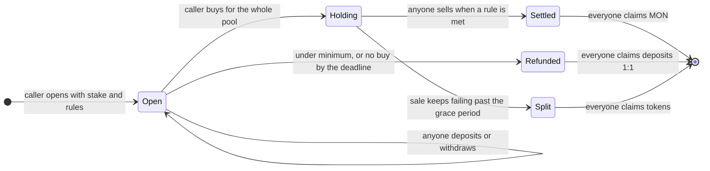
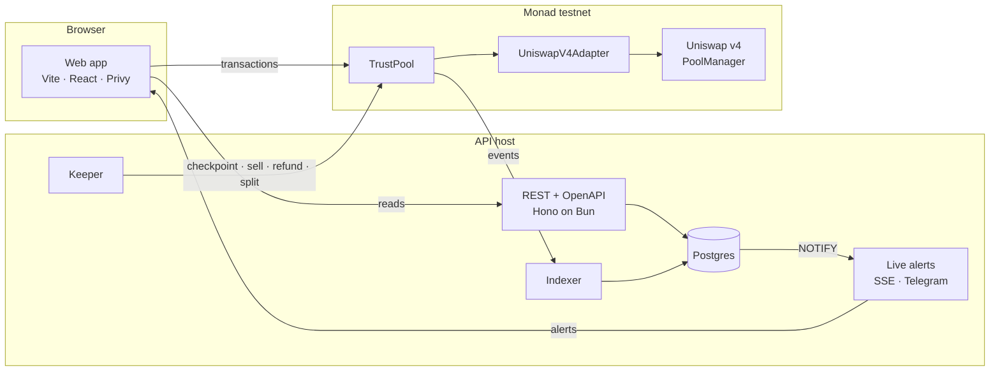

# trustpool

**One buy. One sale. The same price for everyone.**

trustpool turns a crypto call into a shared position. A caller opens a pool on one token,
fixes every rule up front and puts their own MON in first. Anyone can join while the window
is open. The pool then buys once for everyone, sells once for everyone when a rule is met,
and every participant, the caller included, ends with the same percentage. The result goes
on the caller's permanent record, and that record decides how much they may raise next.

[](contracts)
[](#testing)
[](#deployment)
[](contracts/src/adapters/UniswapV4Adapter.sol)
[](apps/api)
[](apps/web)
[](LICENSE)

| | |
|---|---|
| **App** | <https://trustpool.web.id> |
| **Docs** | <https://trustpool.web.id/docs> |
| **API reference** | <https://trustpool.web.id/api/docs> |
| **Contract** | [`0xF21E…Da0E`](https://testnet.monadscan.com/address/0xF21E849d861a70742cC975a8E1E4934f583ADa0E) on Monad testnet |

Built for **Monad Metropolis 2026**. The repository started on 10 October 2026 and its
whole history is the entry (`git log --reverse`).

---

## Contents

[The problem](#the-problem) · [How it works](#how-it-works) · [Worked example](#worked-example) ·
[Architecture](#architecture) · [Guarantees](#guarantees) · [Deployment](#deployment) ·
[Getting started](#getting-started) · [Testing](#testing) · [Known limits](#known-limits) ·
[Security](#security) · [Tech stack](#tech-stack) · [Repository](#repository) ·
[Roadmap](#roadmap) · [Licence](#licence)

---

## The problem

Call groups on Telegram and Discord move a lot of money with no consequence for the caller.
A caller can buy early, post the call, sell into the followers' buying, delete the call when
it goes wrong and start again with a clean history. Followers carry the risk and never see
the caller's own trades.

trustpool removes the head start instead of policing it. The caller's money rides in the same
pool, at the same price, under rules nobody can change, and every result stays on the record.

---

## How it works



1. **Bond.** A caller posts a bond in MON before their first pool. It stays locked while any of
   their pools is open or holding, and the admin can slash it with a public reason.
2. **Open.** The caller sets the token, the window, take-profit, stop-loss, max hold and their
   share of profit, and deposits their stake. All of it is fixed from this transaction on.
3. **Join.** While the window is open anyone deposits MON or takes it back 1:1. Deposits stop at
   the pool's cap, and the caller always keeps at least 5% of the pool.
4. **Buy.** After the window the caller runs one swap for the whole pool. The contract checks
   the cap, the minimum, the caller's share and the price impact (at most 2%), then records the
   tokens that actually arrived.
5. **Watch.** Anyone can record the price: what selling the whole position would return now.
6. **Sell.** Anyone can trigger the sale when two price records, a few minutes apart, both meet
   take-profit or both meet stop-loss, or when max hold is reached and the two agree. The
   contract sets the minimum the sale must return. Whoever sends it earns 0.1%.
7. **Claim.** Each participant claims their share once.

A keeper in the API records prices and triggers sales, refunds and splits as soon as the
contract allows. Every one of those actions is also a button in the app, open to anyone.

### Tiers

The record sets the caller's tier, and the tier sets the cap on the next pool and the largest
profit share they may ask for.

| Tier | Requirement | Pool cap | Max profit share |
|---|---|---|---|
| 0 | fewer than 3 settled, or ever slashed | 2 × bond | 5% |
| 1 | 3 settled, average net return above 0 | 5 × bond | 10% |
| 2 | 10 settled, average net return above 0 | 10 × bond | 15% |
| 3 | 25 settled, average net return above 0 | 20 × bond | 20% |

---

## Worked example

1,000 MON in (caller 100, A 300, B 400, C 200), 10% share of profit, sold for 1,300 MON.
This exact case is a contract test (`test_workedExample_profit`).

```
net      = 1,300 − 0.1% keeper reward   = 1,298.70
profit   = net − 1,000                  =   298.70
fee      = 10% of profit                =    29.87
payout   = net − fee                    = 1,268.83   shared by deposit, caller included

caller   156.75   (126.88 share + 29.87 fee)
A 380.65 · B 507.53 · C 253.77   every participant +26.88%, and the record says +26.88%
```

Sold for 700 MON instead, there is no profit and no fee: everyone, the caller included, ends at
−30.07%, and the record says −30.07% (`test_workedExample_loss`).

---

## Architecture



| Part | Role |
|---|---|
| **TrustPool** | Holds pooled MON, tokens and bonds; enforces every rule; keeps each caller's record and tier. |
| **UniswapV4Adapter** | The only code that touches the DEX. Each pool keeps the adapter it opened with. |
| **Indexer** | Follows contract events into Postgres, samples prices and live caps, lists early buyers. |
| **Keeper** | Simulates, then sends price records, sales, refunds and splits when they are allowed. |
| **Live alerts** | Postgres `NOTIFY` to server-sent events in the app, and to a Telegram channel. |
| **Web app** | Reads from the API, signs transactions in the user's wallet through Privy. |

One API instance indexes and runs the keeper at a time (Postgres advisory lock); any number
can serve reads.

---

## Guarantees

| Guarantee | How the contract enforces it |
|---|---|
| Rules are final | Every rule, the adapter and all timings are copied into the pool at open. No setter, admin included, reaches them. |
| The caller is in first and stays in | Opening requires a stake; the caller cannot withdraw; deposits and the buy both keep the caller at 5% or more. |
| One entry price | The buy is the only path into the token and covers the whole pool. |
| One exit price | The sale covers the whole position; nobody sells alone. |
| No sale on a pushed price | A sale needs two price records a gap apart, and its minimum output comes from them. |
| Results are real | Buys and sales measure balance changes; adapter return values are ignored. |
| Fee on profit only | `fee = max(net − deposits, 0) × share`. |
| No stranded funds | Refunds, token splits, and the last claim taking the remainder. |
| Small market impact | A pool's buy may move the price at most 2%; the cap follows. |
| Admin has no path to pool funds | Admin functions cover the token list, later parameters and bonds only. |

Current parameters are read live on [the docs page](https://trustpool.web.id/docs#rules). The
full design and every decision are in [`docs/pool-spec.md`](docs/pool-spec.md) and
[`docs/product.md`](docs/product.md).

---

## Deployment

Monad testnet, chain 10143, deployed 11 October 2026.

| Contract | Address |
|---|---|
| TrustPool | [`0xF21E849d861a70742cC975a8E1E4934f583ADa0E`](https://testnet.monadscan.com/address/0xF21E849d861a70742cC975a8E1E4934f583ADa0E) |
| UniswapV4Adapter | [`0xA50d9454E71aCf152399C872815ae6895cB53229`](https://testnet.monadscan.com/address/0xA50d9454E71aCf152399C872815ae6895cB53229) |
| tCHOG (demo token) | [`0x12d15135b5bBa8EEF0d1098Aa65A15AF503d09c9`](https://testnet.monadscan.com/address/0x12d15135b5bBa8EEF0d1098Aa65A15AF503d09c9) |
| tMOE (demo token) | [`0x2A8361Ac23F5FfcFDe9f0D7BC7618178770332d0`](https://testnet.monadscan.com/address/0x2A8361Ac23F5FfcFDe9f0D7BC7618178770332d0) |

**Demo setup.** Every swap is a real Uniswap v4 swap against the live PoolManager. The testnet
had no liquid MON pool to trade against, so the two demo tokens and their liquidity are ours.
The pools in the app's history were opened and joined by our own wallets with
[`scripts/seed-demo.ts`](scripts/seed-demo.ts); one of those wallets trades the demo tokens
between a pool's buy and its sale, so the history shows a take-profit and a stop-loss. The
keeper recorded prices and sold each pool on its own.

**Demo parameters.** 0.5 MON bond, 0.05 MON minimum pool, 2 to 10 minute windows, 5 to 30
minute max hold, 3 minutes between price records. With the current demo liquidity a pool can
reach about 0.1 MON before its buy would move the price 2%.

---

## Getting started

**Demo data, no wallet.**

```bash
git submodule update --init
npm install
npm run dev                  # http://localhost:5280
```

Every screen works on demo data with a demo sign-in.

**Full stack on a local chain.** Anvil, contracts, API and web in one command. The app signs
with an anvil key, so every button sends a real transaction.

```bash
npm run dev:local                        # http://127.0.0.1:5290/app
node scripts/local-stack.mjs warp 1h     # move time past a window or a hold
```

**Configuration.** API settings are in [`apps/api/.env.example`](apps/api/.env.example):
`DATA=chain`, `DATABASE_URL` and `PRIVY_APP_ID` for chain mode, `KEEPER_PRIVATE_KEY` for the
keeper, `TELEGRAM_BOT_TOKEN` and `TELEGRAM_CHAT_ID` for channel alerts. On Supabase use the
session pooler (port 5432), which advisory locks and `LISTEN` need. Web settings are in
[`apps/web/.env.example`](apps/web/.env.example).

**Deploying.** From `contracts/`, with `MONAD_TESTNET_RPC` set:

```bash
forge script script/DeployPool.s.sol --network monad --rpc-url monad_testnet --broadcast --account <keystore>
ADD_MON=5 forge script script/DeepenPools.s.sol --network monad --rpc-url monad_testnet --broadcast --account <keystore>
cd .. && npm run sync:contracts
```

`--network monad` makes Foundry apply Monad's EVM rules. `DeepenPools` adds whole MON of
full-range liquidity to each demo pool, which raises the cap.

---

## Testing

```bash
npm test             # contracts (forge) and API (bun)
npm run test:e2e     # a browser drives a whole pooled call on a local chain
npm run typecheck
```

- **Contracts.** Both worked examples to the cent; break-even, a caller under 5%, over cap,
  under minimum, no buy, fee-on-transfer tokens, double claims and a sale that keeps failing;
  rule immutability against every admin setter; every sale guard, including a dump, a price
  record and a sale in one transaction; fuzz tests that every participant gets the same
  percentage; invariants that the contract always holds what it owes.
- **API.** Runs on PGlite locally and Postgres 16 in CI. On anvil, an indexer test checks every
  pool, deposit and record against the contract, and a keeper test drives pools to their end.
- **Fork tests** run the pooled buy and sale against the live testnet PoolManager:

```bash
cd contracts
FORK_RPC_URL=https://testnet-rpc.monad.xyz forge test --network monad --match-path 'test/fork/UniswapV4*'
```

---

## Known limits

- **Second wallets.** A caller can still buy from another wallet before the pool does. Their own
  stake rides the same price, their bond is at stake, and every pool lists the wallets that
  received the token just before its buy, marking any the caller funded directly.
- **Spot prices.** Uniswap v4 has no built-in average price, so the contract uses spot records a
  few minutes apart. A one-block push does nothing; a price held down for a whole gap counts.
- **Fast falls at max hold.** If the price keeps falling more than 2% per gap, the sale waits
  for two records that agree, and the token split after the grace period is the backstop.
- **Fee-on-transfer tokens** that take more than the 2% sale tolerance end in a split. They
  belong off the allow list.
- **One admin key** keeps the token list, sets parameters for later pools and slashes bonds.
- **Small pools.** The 2% impact limit keeps pools to what the token's liquidity can absorb,
  a few hundred dollars on Monad's median token today. That limit is deliberate.
- **Legal.** trustpool is an accountability experiment built for a hackathon and has had no
  legal review.

---

## Security

Slither (102 detectors) and a manual review on 11 October 2026. Every external entry point is
`nonReentrant`, and a test proves each one is closed during a swap. Admin transfer is two-step,
parameters are validated, pausing stops new pools only, and invariant tests check the
contract's balances against what it owes. The API verifies Privy tokens locally, rate-limits
writes, and the keeper simulates every transaction before sending it. Details and accepted
findings: [`docs/product.md`](docs/product.md#security-review). This is a self-review;
there has been no external audit.

---

## Tech stack

| Layer | Tools |
|---|---|
| Contracts | Solidity 0.8.28, Foundry, Uniswap v4 |
| API | Bun, Hono, Drizzle ORM, Postgres (Supabase) or PGlite, viem |
| Web | Vite, React 18, Tailwind, motion, react-router, Privy, viem |
| Testing | forge (unit, fuzz, invariant, fork), bun test, Playwright |
| Hosting | nginx and systemd on a VPS, Let's Encrypt |

---

## Repository

```
contracts/
  src/TrustPool.sol         the pooled-call contract
  src/adapters/             Uniswap v4 (live), Uniswap v2 and nad.fun adapters
  src/v4/                   demo token and liquidity seeder for testnet
  script/                   DeployPool, DeepenPools, DeployV4, SeedLocal
  test/                     unit, fuzz, invariant, fork
packages/core/              shared types, demo data, generated ABIs and addresses
apps/api/                   http, indexer, keeper, live alerts, store, db
apps/web/                   landing, docs and app
e2e/                        Playwright stories on anvil
scripts/                    local stack, ABI sync, testnet seed
docs/                       pool-spec, product, design, writeup
```

---

## Roadmap

- A time-weighted price once a Monad DEX offers one.
- Slashing by a council or on-chain evidence in place of one admin key.
- Reputation that decays with inactivity (`lastActive` is already recorded).
- nad.fun adapter on mainnet (written; fork test pending).

---

## Licence

MIT. See [LICENSE](LICENSE).
